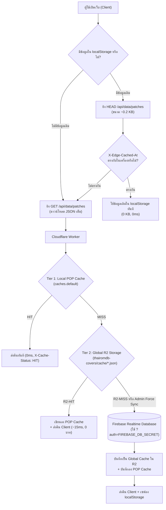

# สถาปัตยกรรม R2 Global Cache และการล็อคสิทธิ์ Firebase RTDB

เอกสารนี้รวบรวมองค์ความรู้ (Knowledge) และขั้นตอนการติดตั้ง (Setup Guide) สำหรับระบบ **Cloudflare R2 Global Cache** และการ **ปิดสิทธิ์ Public Read บน Firebase Realtime Database** ของโปรเจกต์ **THAI ROM DB** เพื่อป้องกันไม่ให้โควตาดาวน์โหลดของ Firebase RTDB รั่วไหลหรือเกินขีดจำกัด 10 GB/เดือน อย่างถาวร

---

## 1. ปัญหาและที่มา (Problem Statement)

หลังจากติดตั้งระบบ Cloudflare Edge Cache ในระยะแรก ยอดดาวน์โหลดของ Firebase RTDB ลดลงจาก 600–750 MB/วัน เหลือประมาณ 260–280 MB/วัน แต่ยังไม่ลดลงเหลือ 0–10 MB ตามที่คาดหวัง จากการตรวจสอบพบสาเหตุ 2 ประการ:

1. **Cloudflare Cache API (`caches.default`) แยกตาม Data Center (POP):**
   - Cloudflare มี Data Center กว่า 300 แห่งทั่วโลก แคชของ Worker ไม่ได้แชร์ข้ามศูนย์ข้อมูลกัน
   - ผู้ใช้จาก ISP ต่างกัน (AIS, True, 3BB, NT) หรือจากต่างประเทศ วิ่งเข้าคนละ Data Center ทำให้เกิด Cache MISS และยิงไปดึง `/patches.json` (ขนาด 488 KB) จาก Firebase บ่อยครั้ง
2. **Client เก่าและบอทยังยิงตรงเข้า Firebase RTDB:**
   - ผู้ใช้ที่เปิดแท็บทิ้งไว้บนมือถือยังคงรันโค้ดเก่าใน Service Worker ซึ่งดึงข้อมูลตรงจาก Firebase SDK
   - สิทธิ์ของ Firebase RTDB เดิมตั้งไว้เป็น `.read: true` ทำให้บุคคลภายนอกหรือบอทสามารถขอไฟล์ JSON ทั้งก้อนได้โดยตรง

---

## 2. สถาปัตยกรรมแคช 2 ชั้น (Multi-Tier Global Cache Architecture)



### จุดเด่นของสถาปัตยกรรมนี้:
* **Tier 1 (POP Memory Cache):** ให้ความเร็วสูงสุด 0ms เมื่อมีการเรียกซ้ำใน Data Center เดียวกัน
* **Tier 2 (Cloudflare R2 Global Cache):** เก็บไฟล์ `cache/{collection}.json` ไว้ใน R2 Bucket ซึ่งสามารถเข้าถึงได้จากทุก Data Center ทั่วโลก โดยไม่มีค่าธรรมเนียม Egress ($0 Egress Fee) และอ่านได้ฟรีภายใต้โควตา Class B Operations 10 ล้านครั้ง/เดือน
* **Tier 3 (Firebase RTDB):** จะถูกเรียกก็ต่อเมื่อ R2 ยังไม่มีข้อมูล หรือเมื่อแอดมินกดปุ่ม **"ซิงค์ข้อมูล Edge"** เท่านั้น

---

## 3. การล็อคสิทธิ์ความปลอดภัย (Firebase RTDB Rules Lockdown)

เพื่อตัดวงจรโค้ดเก่าในเครื่องผู้ใช้และบอทที่ยิงดึงข้อมูล 488 KB โดยตรง มีการปรับปรุง [database.rules.json](file:///d:/me/rom_collector/database.rules.json) ดังนี้:

```json
{
  "rules": {
    ".read": "auth != null && root.child('admins').child(auth.uid).exists()",
    ".write": false,
    "patches": {
      ".read": "auth != null && root.child('admins').child(auth.uid).exists()",
      "$id": {
        ".read": true,
        ".write": "auth != null && root.child('admins').child(auth.uid).exists()",
        ".validate": "..."
      }
    }
  }
}
```

* **ผลลัพธ์ของการตั้งค่า:**
  * การเรียก `GET /patches.json` (ข้อมูลทั้งก้อน 488 KB) แบบ Anonymous หรือจาก Client เก่า จะได้รับผลลัพธ์เป็น **`401 Permission Denied` (ขนาดจิ๋วเพียง ~50 Bytes)** ทันที ช่วยประหยัดโควตาและบีบให้ผู้ใช้ต้องรีเฟรชหน้าเว็บ
  * การเรียกดูข้อมูลเกมเดี่ยวรายตัว (`/patches/{id}.json`) ยังคงเปิดให้อ่านได้ปกติ (`.read: true`)
  * Cloudflare Worker สามารถอ่านข้อมูลทั้งก้อนได้โดยส่ง Database Secret ผ่าน Query Parameter `?auth=...` ซึ่งมีสิทธิ์ Admin Bypass อัตโนมัติ

> [!NOTE]
> **คำเตือน "Database secrets are currently deprecated...":**
> ในหน้า Firebase Console จะมีข้อความเตือนว่า Database Secrets เป็นระบบ Legacy ซึ่ง Google แนะนำให้โปรเจกต์ใหม่ใช้ Service Account / Admin SDK แทน แต่ระบบนี้ยังคงใช้งานได้ปกติ 100% และเป็นวิธีที่เบาที่สุดสำหรับ Cloudflare Worker ในการเรียก HTTP REST API โดยไม่ต้องทำ OAuth 2.0 Token Handshake ทุกชั่วโมง

---

## 4. คู่มือขั้นตอนการติดตั้ง (Step-by-Step Setup Guide)

### ขั้นตอนที่ 1: คัดลอก Database Secret จาก Firebase Console
1. เข้าไปยัง [Firebase Console](https://console.firebase.google.com/) แล้วเลือกโปรเจกต์ `thairomdb`
2. ไปที่รูปเฟือง ⚙️ ด้านบนซ้าย > **Project settings** (การตั้งค่าโปรเจกต์)
3. เลือกแท็บ **Service accounts** (บัญชีบริการ)
4. ในแถบเมนูด้านซ้าย เลือกหัวข้อ **Database secrets**
5. เลื่อนลงมาที่ตารางด้านล่าง เอาเมาส์ไปชี้ที่จุดไข่ปลา `•••••••••••••••` ของฐานข้อมูล `thairomdb-default-rtdb`
6. กดปุ่มรูปดวงตาหรือปุ่มคัดลอก (Copy) เพื่อเก็บค่า Secret ไว้

---

### ขั้นตอนที่ 2: ตั้งค่า Secret ให้กับ Cloudflare Worker
เปิด Terminal หรือ Command Prompt ในเครื่อง แล้วรันคำสั่ง:

```bash
cd r2-worker
npx wrangler secret put FIREBASE_DB_SECRET
```

เมื่อระบบถาม `Enter a secret value:` ให้วางค่า Secret ที่คัดลอกมาจากขั้นตอนที่ 1 แล้วกด Enter

---

### ขั้นตอนที่ 3: Deploy Cloudflare Worker
รันคำสั่ง deploy เพื่ออัปเดตโค้ด Worker รุ่นล่าสุดที่มีระบบ R2 Global Cache:

```bash
cd r2-worker
npx wrangler deploy
```

*(หรือดับเบิลคลิกไฟล์ [r2-worker/_deploy_worker.bat](file:///d:/me/rom_collector/r2-worker/_deploy_worker.bat))*

---

### ขั้นตอนที่ 4: Deploy กฎความปลอดภัยขึ้น Firebase RTDB
รันคำสั่งเพื่ออัปเดต [database.rules.json](file:///d:/me/rom_collector/database.rules.json) ขึ้น Firebase:

```bash
firebase deploy --only database
```

---

### ขั้นตอนที่ 5: ตรวจสอบความถูกต้อง (Verification)
1. **ทดสอบยิงดึงข้อมูลผ่าน Worker:**
   ```bash
   curl -I https://r2-upload-worker.thairomdb.workers.dev/api/data/patches
   ```
   * ตรวจสอบว่าได้สถานะ `HTTP/1.1 200 OK`
   * Header `X-Cache-Status` ควรแสดงเป็น `HIT` หรือ `R2-HIT`
2. **ทดสอบความปลอดภัยของ Firebase RTDB (ต้องติด Permission Denied):**
   ```bash
   curl -I https://thairomdb-default-rtdb.asia-southeast1.firebasedatabase.app/patches.json
   ```
   * ต้องได้สถานะ `HTTP/1.1 401 Unauthorized` (ขนาด Response ~50 Bytes) ซึ่งยืนยันว่าบอทและ Client เก่าถูกบล็อกจากการดึง 488 KB เรียบร้อยแล้ว

---

## 5. การสั่งล้างแคชและอัปเดตข้อมูล (Cache Maintenance)

* **สำหรับผู้ดูแลระบบ (Admin):**
  * เมื่อเพิ่มหรือแก้ไขเกมในระบบเสร็จสิ้น ให้ไปที่แถบเมนูข้าง (Sidebar) แล้วกดปุ่ม **"ซิงค์ข้อมูล Edge"**
  * ระบบจะส่งคำขอ `?fresh=true` พร้อม `X-Purge-Key` ไปยัง Worker
  * Worker จะดึงข้อมูลล่าสุดจาก Firebase RTDB มาอัปเดตลง R2 Global Cache และ POP Cache ทันทีในคำขอเดียว
* **การล้างแคชผ่าน API (กรณีฉุกเฉิน):**
  ```bash
  curl -X POST "https://r2-upload-worker.thairomdb.workers.dev/api/clear-cache?collection=patches" \
       -H "X-Purge-Key: thairomdb-cache-key-2026"
  ```
