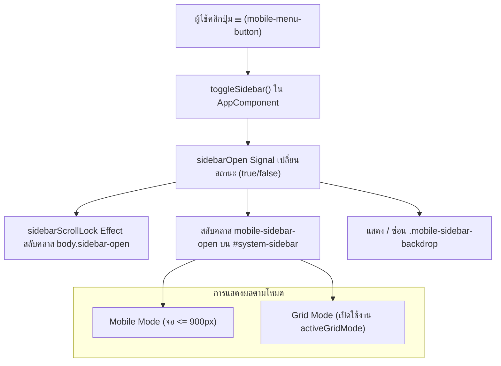

# Mobile Mode & Grid Mode Sidebar Toggle Knowledge & Architecture

เอกสารบันทึกสถาปัตยกรรม การออกแบบ กลไกเชิงเทคนิค และแนวทางการดูแลรักษาฟีเจอร์ **Sidebar Drawer Toggle** ของระบบ ซึ่งถูกใช้งานร่วมกันระหว่าง **Mobile Mode** และ **Pinterest Grid Mode**

---

## 1. ภาพรวมและหลักการออกแบบร่วม (Unified Toggle Concept)

ระบบ THAI ROM DB ออกแบบระบบเปิด-ปิดเมนูนำทาง (Sidebar Drawer) ให้ใช้ **ปุ่ม, สถานะตัวแปร และวงจรชีวิต (Lifecycle) ชุดเดียวกัน 100%** เพื่อลดความซ้ำซ้อนของโค้ดและมอบประสบการณ์ใช้งานที่สม่ำเสมอในทุกขนาดหน้าจอ



### 1.1 ไฟล์ที่เกี่ยวข้องโดยตรง
- **Template:** [`web/src/app/app.component.html`](file:///d:/me/rom_collector/web/src/app/app.component.html)
- **Component Logic:** [`web/src/app/app.component.ts`](file:///d:/me/rom_collector/web/src/app/app.component.ts)
- **Styles:** [`web/src/app/app.component.css`](file:///d:/me/rom_collector/web/src/app/app.component.css)
- **Global Styles:** [`web/src/styles.css`](file:///d:/me/rom_collector/web/src/styles.css)
- **Grid Mode Service:** [`web/src/app/services/browse-grid-mode.service.ts`](file:///d:/me/rom_collector/web/src/app/services/browse-grid-mode.service.ts)

---

## 2. การควบคุมการแสดงผลปุ่ม Toggle (☰)

ปุ่ม Hamburger (`.mobile-menu-button`) ถูกติดตั้งไว้ที่มุมซ้ายสุดของ Header หน้าโลโก้:

```html
<button class="mobile-menu-button" 
  [class.mobile-menu-button--grid]="gridModeService.activeGridMode()"
  type="button" 
  (click)="toggleSidebar()" 
  [attr.aria-expanded]="sidebarOpen()" 
  aria-controls="system-sidebar"
  aria-label="Toggle navigation menu">☰</button>
```

### กฎการแสดงผลใน CSS
1. **บน Desktop โหมดปกติ (List Mode จอ > 900px):**
   - ปุ่มจะถูกซ่อน (`display: none;`) เนื่องจากหน้าเว็บแสดงผลแบบ 3 คอลัมน์เต็มพื้นที่ มี Sidebar ซ้ายและขวาอยู่บนหน้าจออยู่แล้ว
2. **บน Mobile Mode (จอ $\le$ 900px):**
   - แสดงปุ่มอัตโนมัติ (`display: inline-block;`) เพื่อเปิด Drawer
3. **บน Grid Mode (ทุกขนาดหน้าจอ $\ge$ 480px):**
   - มีการใส่คลาส `.mobile-menu-button--grid` เพื่อบังคับให้ปุ่มแสดงผลเสมอ (`display: inline-block !important;`) แม้อยู่บนหน้าจอ Desktop กว้างพิเศษ เพื่อให้ผู้ใช้สามารถเรียกเปิดเมนู Drawer ได้ตลอดเวลา

---

## 3. การรวมเนื้อหาเข้าสู่ Drawer (Content Consolidation)

ในโหมด Desktop แบบปกติ เนื้อหาจะถูกแบ่งออกเป็น 2 ฝั่ง:
- **Left Sidebar (`#system-sidebar`):** เมนูหลัก THAI ROM DB, เมนู Admin, รายชื่อแพลตฟอร์ม (Systems), และรายชื่อทีมแปล (Translators)
- **Right Sidebar (`.right-ad-sidebar`):** เมนูรอง (`secondarySidebar`) ได้แก่ บทความ, Tags, ข้อมูลบริจาค/การสนับสนุน, ลิงก์อื่นๆ, ตัวนับสถิติผู้เข้าชม และตัวเลือกเปลี่ยนธีม

### กลยุทธ์ใน Mobile และ Grid Mode (Full Mobile-Like Sidebar)
เมื่อเข้าสู่ Mobile Mode หรือ Grid Mode ตัว Right Sidebar จะถูกซ่อนออกไป (`display: none !important;`) เพื่อให้พื้นที่ตรงกลางขยายได้เต็มที่ ดังนั้นจึงต้องดึงเนื้อหา `secondarySidebar` ทั้งหมดมารวมไว้ที่ส่วนท้ายของ Left Sidebar Drawer:

```html
<!-- ฝั่ง Left Sidebar: แสดงเมื่อเป็น Mobile หรืออยู่ใน Grid Mode -->
@if (!isDesktop() || gridModeService.activeGridMode()) {
<ng-container *ngTemplateOutlet="secondarySidebar"></ng-container>
}

<!-- ฝั่ง Right Sidebar: แสดงเฉพาะบน Desktop ที่ไม่ได้เปิด Grid Mode -->
@if (isDesktop() && !gridModeService.activeGridMode()) {
<ng-container *ngTemplateOutlet="secondarySidebar"></ng-container>
}
```

**ประโยชน์:**
1. ผู้ใช้ Grid Mode สามารถเข้าถึงบทความ, Tags, และเปลี่ยนธีมได้ครบถ้วน 100% เช่นเดียวกับผู้ใช้ Mobile
2. ไม่สร้าง DOM Element ซ้ำซ้อนใน Right Sidebar ขณะซ่อนอยู่

---

## 4. ปัญหา Document Flow และการป้องกันเนื้อหาเลื่อน (Zero-Shift Architecture)

### 4.1 สาเหตุที่เนื้อหาเลื่อนขึ้น (Root Cause of Layout Shift)
เดิมทีเมื่อเปิด Sidebar Drawer ตัว Header (`.app-header`) ถูกกำหนดเป็น `position: fixed` ทั่วทั้งระบบ:
1. **Header หลุดออกจาก Document Flow บน Desktop:** เมื่อ Header เปลี่ยนเป็น `position: fixed` จะทำให้ความสูงของ Header (~77-80px) หายไปจาก Flow ส่งผลให้ `.app-shell` ขยับขึ้นไปที่ `top: 0` ทันที
2. **บั๊กตกค้างจากกฎ `.is-vip`:** ในอดีต แถบ Marquee เคยถูกซ่อนเมื่อผู้ใช้เป็น VIP จึงมีกฎตั้งค่า `padding-top: 2.75rem` (44px) ไว้ แต่ปัจจุบันแถบ Marquee แสดงผลเสมอสำหรับทุกคน ทำให้ผู้ใช้ที่มีสิทธิ์ VIP/Admin เจอปัญหาเนื้อหาเลื่อนมุดขึ้นไปใต้ Header ทันทีถึง 36px
3. **ความคลาดเคลื่อนของขนาด Rem กับ Font Rendering:** การใช้ค่าคงที่ `5rem` (80px) อาจไม่ตรงกับความสูงที่แท้จริงของ Header (เช่น 76.75px หรือ 82px) ทำให้เกิดการกระตุกเล็กน้อย

### 4.2 สถาปัตยกรรม Zero-Shift: แยกการทำงานระหว่าง Desktop และ Mobile
เพื่อแก้ปัญหาการเลื่อนของเนื้อหาใน Grid Mode อย่างสมบูรณ์แบบ (0px Shift):

1. **บน Desktop (`min-width: 901px`):**
   - Header **ไม่เปลี่ยนเป็น `position: fixed`** แต่ใช้ `position: relative; z-index: 30;`
   - Header ยังคงอยู่ใน Normal Document Flow ตามธรรมชาติ ไม่สูญเสียความสูง และดัน `.app-shell` ให้อยู่ในระนาบเดิม 100%
   - ไม่จำเป็นต้องใส่ `padding-top` ชดเชยใดๆ บน `.app-shell` (`padding-top: 0`)
   - `z-index: 30` ช่วยให้ปุ่ม ☰ และ Header อยู่เหนือ Drawer (`z-index: 20`) และ Backdrop (`z-index: 15`) เสมอ
   - ผลลัพธ์: การเปิด/ปิด Sidebar Drawer ใน Grid Mode บนหน้าจอคอมพิวเตอร์จะไม่มีการเลื่อนขยับของเนื้อหาแม้แต่พิกเซลเดียว (`shift = 0px`) ทั้งผู้ใช้ทั่วไปและ VIP/Admin

2. **บน Mobile (`max-width: 900px`):**
   - Header ถูกตรึงไว้ด้วย `position: fixed; top: 0; left: 0; right: 0; z-index: 30;`
   - `.app-shell` ได้รับ `padding-top: 5rem;` สม่ำเสมอกันทุกผู้ใช้ (ยกเลิกกฎ `.is-vip 2.75rem` โดยสิ้นเชิง)

```css
/* Mobile Mode: Header Fixed + Padding ชดเชย 5rem */
@media (max-width: 900px) {
  :host-context(body.sidebar-open) .app-header {
    left: 0;
    position: fixed;
    right: 0;
    top: 0;
    z-index: 30;
  }

  .status-message {
    left: 0;
  }

  :host-context(body.sidebar-open) .app-shell {
    padding-top: 5rem;
  }
}

/* Desktop Grid Mode: Relative Header + 0px Shift */
@media (min-width: 901px) {
  :host-context(body.sidebar-open) .app-header {
    position: relative;
    z-index: 30;
  }

  :host-context(body.sidebar-open) .app-shell.is-grid-mode {
    padding-top: 0;
  }
}
```

### 4.3 กฎ Header Offset บนตัว Drawer (`padding-top: 5.5rem`)
ตัว Drawer เอง (`.retro-rail.mobile-sidebar-open`) ถูกกำหนด `position: fixed; top: 0; bottom: 0;` เพื่อให้เลื่อนได้เต็มความสูงหน้าจอ จึงต้องมี `padding-top: 5.5rem` ดันรายการเมนูด้านในลงมา เพื่อไม่ให้แถบ Header และ Marquee ด้านบนบังหัวข้อเมนูแรก

---

## 5. การจัดลำดับชั้น Layering (Z-Index Hierarchy) & Scroll Lock

เพื่อให้การแสดงผลและการมีปฏิสัมพันธ์ (Interaction) ถูกต้อง ไม่เกิดการคลิกผิดชั้น:

| ระดับชั้น (Layer) | คลาส / Selector | ค่า z-index | บทบาทและหน้าที่ |
|---|---|---|---|
| **Header Controls** | `.app-header` | `z-index: 30` | อยู่ชั้นบนสุดเพื่อให้ปุ่ม ☰ มองเห็นและกดปิดได้เสมอ |
| **Drawer Navigation** | `.retro-rail.mobile-sidebar-open` | `z-index: 20` | แผงเมนูสไลด์ออกมาจากด้านซ้าย เลื่อนดูเมนูได้อิสระ |
| **Overlay Backdrop** | `.mobile-sidebar-backdrop` | `z-index: 15` | แผ่นฟิล์มสีเข้มโปร่งแสงคลุมหน้าจอเดิม รองรับการคลิกเพื่อปิด |
| **Page Content** | `.app-shell`, `.app-content` | Default / Auto | เนื้อหาของหน้าเว็บด้านล่าง |

### การล็อกการเลื่อนหน้าจอ (Scroll Lock)
เมื่อเปิด Drawer ระบบจะผูก Effect ใน [`AppComponent`](file:///d:/me/rom_collector/web/src/app/app.component.ts) เพิ่มคลาส `sidebar-open` ลงในแท็ก `<body>`:
```css
body.sidebar-open {
  overflow: hidden;
}
```
ช่วยป้องกันไม่ให้หน้าเว็บด้านหลังเลื่อนตามเมื่อผู้ใช้ทำการ Scroll อยู่ภายใน Drawer

---

## 6. วงจรชีวิตการปิดเมนู (Dismissal Lifecycle)

ผู้ใช้สามารถสั่งปิด Sidebar Drawer ได้ผ่าน 5 ช่องทาง ซึ่งทั้งหมดจะเรียกไปยัง `closeSidebar()`:
1. **คลิกปุ่ม ☰ ซ้ำ:** สลับสถานะเปิด-ปิด
2. **คลิกพื้นที่ Backdrop ด้านนอก:** แตะหรือคลิกที่บริเวณเงาสีดำเพื่อปิดทันที
3. **กดปุ่ม Escape บนคีย์บอร์ด:** ตรวจจับผ่าน `@HostListener('document:keydown.escape')`
4. **คลิกลิงก์นำทางภายในเมนู:** ทุกลิงก์ (เช่น เปลี่ยนหน้า, เลือกหมวดหมู่, เลือกทีมแปล, เลือก Tag, เลือกบทความ) มีคำสั่ง `closeSidebar()` กำกับไว้เสมอ
5. **การเปลี่ยน Route:** เมื่อ Router ทำงานเสร็จสิ้นจะปิดเมนูอัตโนมัติ

---

## 7. ข้อควรระวังในการทดสอบ (Unit Testing Guidelines)

1. **การทดสอบ Desktop List Mode ปกติ:**
   - เนื่องจากระบบกำหนดให้ Grid Mode เป็นโหมดเริ่มต้น (`default = true`) หากต้องการเขียน Unit Test สำหรับทดสอบการแสดงผล Desktop 3 คอลัมน์แบบดั้งเดิม หรือทดสอบ Right Sidebar ต้องสั่งปิด Grid Mode ก่อนเสมอ:
     ```typescript
     const gridModeService = TestBed.inject(BrowseGridModeService);
     gridModeService.setGridMode(false);
     ```
2. **การทดสอบ Hit Counter / Secondary Section:**
   - ใน Grid Mode ตัว `.hit-counter` จะอยู่ใน `#system-sidebar`
   - ใน Desktop List Mode ตัว `.hit-counter` จะอยู่ใน `.right-ad-sidebar`
3. **การทดสอบ Escape Key:**
   - สามารถจำลองการกด Escape ผ่าน `document.dispatchEvent(new KeyboardEvent('keydown', { key: 'Escape' }))` แล้วตรวจสอบว่า `sidebarOpen()` กลายเป็น `false`
